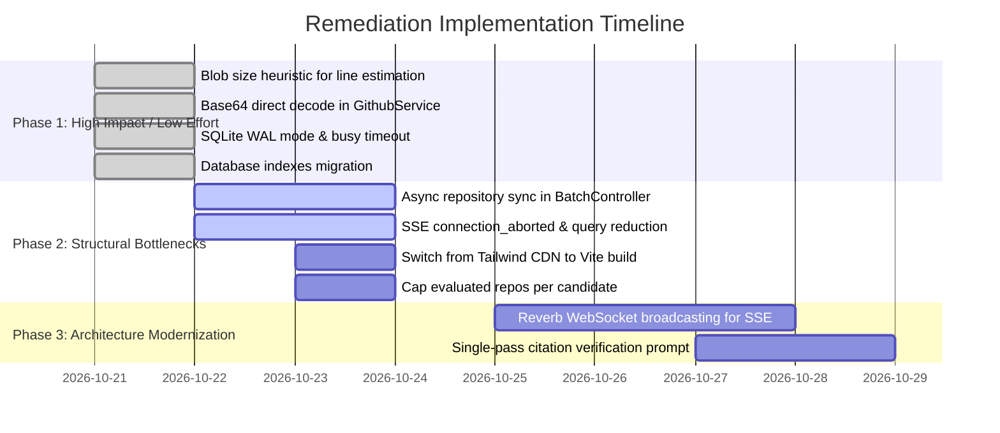

# Performance Audit — ColoredCow Technical Candidate Evaluator

> **Audit Date:** October 2026  
> **Application:** ColoredCow Technical Candidate Evaluator  
> **Stack:** Laravel 13 · PHP 8.3 · SQLite · Blade / Tailwind / Alpine.js · Vite 8  
> **Scope:** Full-stack performance, latency, throughput, resource consumption, and scalability bottlenecks.

---

## Executive Summary

The ColoredCow Technical Candidate Evaluator is an AI-powered multi-dimensional assessment platform. While functionally rich with GitHub ingestion, multi-provider LLM evaluations, citation verification, and SSE progress tracking, the codebase currently suffers from severe architectural bottlenecks that prevent reliable multi-candidate or batch evaluations.

### Key Metrics & Findings Overview

| Category | Severity | Primary Root Cause | Real-World Impact |
|:---|:---:|:---|:---|
| **GitHub Ingestion** | 🔴 **CRITICAL** | Up to 100 sequential HTTP calls per repo in `estimateLines()`; uncapped repo sync | 30–120s latency per repo; API rate limit exhaustion; job timeouts |
| **Batch Processing** | 🔴 **CRITICAL** | Synchronous GitHub API calls executed inside the CSV upload web request loop | HTTP 504 Gateway Timeouts on batch uploads with >5 candidates |
| **SSE Streaming** | 🔴 **CRITICAL** | Long-polling SSE loop with `sleep(2)` without `connection_aborted()` checking | Complete PHP-FPM / web worker pool exhaustion under concurrent viewers |
| **Database & Locking** | 🔴 **CRITICAL** | SQLite file locking with session, queue, cache, and app data all sharing one SQLite file | `Database is locked` crashes under queue concurrency; table scans from missing indexes |
| **AI Dual-Pass** | 🟠 **HIGH** | Synchronous `CitationValidator::supportCheck` doubles LLM latency and costs | 2× API costs; adds 15–45s latency per evaluation |
| **Frontend Delivery** | 🟠 **HIGH** | In-browser Tailwind JIT CDN (~340 KB) loaded on every page; unbundled global Chart.js | 200–400ms First Paint delay; high layout shifts and CPU overhead |

---

## Severity Classification

- 🔴 **CRITICAL**: Causes application failures, process timeouts, worker starvation, or database lock crashes under normal concurrent operations.
- 🟠 **HIGH**: Substantial latency or throughput penalty, unnecessary API costs, or heavy memory consumption.
- 🟡 **MEDIUM**: Inefficient query patterns, redundant computations, or sub-optimal caching.
- 🟢 **LOW**: Code cleanliness, minor memory optimizations, and future-proofing.

---

## 1. GitHub API & Repository Ingestion (The 100+ Request Bottleneck)

### 🔴 1.1 `estimateLines()` Fires Up to 100 Sequential HTTP Requests Per Repo
- **Location:** [`app/Services/RepositoryAnalyzer.php:92–113`](file:///d:/website/operationsflow-hr/app/Services/RepositoryAnalyzer.php#L92-L113)
- **Problem:** To estimate lines of code, `estimateLines()` loops through up to 50 code files and invokes `GithubService::getFileContent()` for each file. Internally, `getFileContent()` issues **two** serial HTTP requests:
  1. `GET /repos/{owner}/{repo}/contents/{path}`
  2. `GET {download_url}`
  
  This results in up to **100 serial HTTP round-trips** per repository purely for line-counting.
- **Latency Impact:** At an average GitHub API round-trip of 250ms, this single method consumes **25 to 35 seconds per repository**. For a candidate with 3 repositories, line estimation alone takes over 1.5 minutes and burns 300 GitHub API requests.
- **Remediation:**
  1. Do not download full files just to estimate line count. Use the blob `size` attribute already available in the Git Tree response (`lines ≈ size / 35`).
  2. If exact lines are required for key files, sample at most 3–5 representative files or execute parallel fetches using `Http::pool()`.

```diff
- foreach (array_slice($codeFiles, 0, 50) as $file) {
-     $content = $this->github->getFileContent($owner, $repoName, $file);
-     if ($content !== null) {
-         $lines = count(explode("\n", $content));
-         $totalLines += $lines;
-         $sampledFiles++;
-     }
- }
+ // Heuristic line estimation using Git Tree blob sizes (0 additional HTTP calls)
+ foreach ($codeFiles as $file) {
+     $size = $fileSizes[$file] ?? 0;
+     $totalLines += (int) round($size / 38);
+     $sampledFiles++;
+ }
```

---

### 🔴 1.2 Uncapped Repository Syncing & Analysis
- **Location:** [`app/Services/GithubService.php:286–300`](file:///d:/website/operationsflow-hr/app/Services/GithubService.php#L286-L300) & [`app/Services/EvaluationOrchestrator.php:93–117`](file:///d:/website/operationsflow-hr/app/Services/EvaluationOrchestrator.php#L93-L117)
- **Problem:** When syncing a candidate's GitHub profile, `syncCandidateRepos()` requests up to **100 repositories** (`perPage = 100`). It creates all non-fork repositories in the database. Subsequently, `EvaluationOrchestrator::analyzeRepos()` loops through **every single repository** linked to the candidate:
  ```php
  foreach ($repositories as $repo) {
      $analysis = $this->analyzer->analyze($repo);
  }
  ```
  If an applicant has 15 personal repositories on GitHub, the orchestrator analyzes all 15 serially. At 50–100 calls per repo, this executes **750 to 1,500 GitHub API calls** for a single candidate, exceeding the candidate timeout (600s) and exhausting the GitHub token rate limit (5,000/hr).
- **Remediation:**
  - Cap analyzed repositories to the top 3–5 most relevant repos (ordered by stargazers count, recency of push, and primary language relevance).
  - Allow HR reviewers or candidates to select the primary repositories evaluated.

---

### 🟠 1.3 `getFileContent()` Double-Fetches Base64 Content
- **Location:** [`app/Services/GithubService.php:180–205`](file:///d:/website/operationsflow-hr/app/Services/GithubService.php#L180-L205)
- **Problem:** GitHub's Contents API returns the file content as base64-encoded text for files under 1 MB (`$response['content']`). Currently, `getFileContent()` ignores the base64 content and issues a second request to `download_url`:
  ```php
  $downloadUrl = $contents['download_url'] ?? null;
  $rawResponse = Http::withHeaders($this->headers())->get($downloadUrl);
  return $rawResponse->body();
  ```
- **Latency Impact:** Doubles the HTTP round-trip latency for every single file retrieved across the entire system (`estimateLines`, `ArtifactContentFetcher`, etc.).
- **Remediation:**
  ```php
  if (!empty($contents['content']) && ($contents['encoding'] ?? '') === 'base64') {
      return base64_decode($contents['content']);
  }
  // Only fall back to download_url for files lacking inline base64
  ```

---

### 🟠 1.4 Redundant Artifact Excerpt Fetching
- **Location:** [`app/Services/Evaluation/ArtifactContentFetcher.php:17–39`](file:///d:/website/operationsflow-hr/app/Services/Evaluation/ArtifactContentFetcher.php#L17-L39)
- **Problem:** `RepositoryAnalyzer` runs `estimateLines()` across 50 files. Later in the same pipeline, `ArtifactContentFetcher` fetches 10 artifact files via `GithubService::getFileContent()`. Files like `README.md`, `composer.json`, and core controllers are often fetched twice within the same job.
- **Remediation:**
  - Introduce an in-memory repository file cache in `GithubService` scoped to the current execution, ensuring no repository path is fetched more than once per job.

---

### 🟡 1.5 Rate-Limit Sleep Blocks Queue Worker Threads
- **Location:** [`app/Services/GithubService.php:54–63`](file:///d:/website/operationsflow-hr/app/Services/GithubService.php#L54-L63)
- **Problem:** When a 429 or rate-limit status is returned by GitHub, `handleRateLimit()` executes `sleep($waitSeconds)`. If rate-limited for 60 seconds, the queue worker process halts completely in synchronous sleep, blocking all other queued jobs on that worker.
- **Remediation:**
  - Throw a `RateLimitedException` and utilize Laravel queue's `release($waitSeconds)` so the worker can process other non-GitHub jobs while releasing the locked candidate evaluation.

---

## 2. Real-Time SSE & Web Server Starvation

### 🔴 2.1 Web Worker Starvation via Long-Lived Synchronous SSE Loops
- **Location:** [`app/Http/Controllers/Api/EvaluationProgressController.php:46–93`](file:///d:/website/operationsflow-hr/app/Http/Controllers/Api/EvaluationProgressController.php#L46-L93)
- **Problem:** The SSE stream uses an internal `while ($iteration < $maxIterations)` loop with `sleep(2)` spanning up to **600 iterations (20 minutes)**:
  ```php
  while ($iteration < $maxIterations) {
      $candidate->refresh();
      $progress = $candidate->latestProgress;
      // ...
      sleep(2);
      $iteration++;
  }
  ```
- **Process Impact:** PHP applications running under traditional web servers (PHP-FPM, Apache `mod_php`, or `php artisan serve`) allocate one worker thread/process per open connection.
  - If a team of HR reviewers opens 10 candidate tabs or a batch evaluation view, **10 PHP workers are pinned for up to 20 minutes**.
  - On a server with 10–20 PHP-FPM workers, the entire web application becomes unresponsive to all other users (504 Gateway Timeout).
- **Remediation:**
  1. **Short-term:** Lower `maxIterations` to 120 (4 minutes) and increase polling interval to 3–4 seconds.
  2. **Production architecture:** Replace SSE polling with event broadcasting using **Laravel Reverb**, Pusher, or Redis Pub/Sub, freeing web workers instantly.

---

### 🟠 2.2 Unchecked Client Disconnects (Zombie Loop Execution)
- **Location:** [`app/Http/Controllers/Api/EvaluationProgressController.php:49–93`](file:///d:/website/operationsflow-hr/app/Http/Controllers/Api/EvaluationProgressController.php#L49-L93)
- **Problem:** The streaming loop lacks `connection_aborted()` checks. If a user closes the browser tab or navigates away, the server continues looping, refreshing the model and querying the database every 2 seconds for up to 20 minutes.
- **Remediation:**
  ```php
  if (connection_aborted()) {
      break;
  }
  ```

---

### 🟠 2.3 SSE Polling Query Density & DB Overload
- **Location:** [`app/Http/Controllers/Api/EvaluationProgressController.php:50–51`](file:///d:/website/operationsflow-hr/app/Http/Controllers/Api/EvaluationProgressController.php#L50-L51)
- **Problem:** Each iteration executes `$candidate->refresh()` (re-reading all candidate columns) and `$candidate->latestProgress` (which fires `$this->progress()->latest()->first()`). That is at least 2 database queries every 2 seconds per connected client.
- **Remediation:** Query only the required columns and avoid full model hydrations during poll ticks:
  ```php
  $progressData = DB::table('evaluation_progress')
      ->where('candidate_id', $candidate->id)
      ->latest('id')
      ->first(['id', 'event_id', 'status', 'current_step', 'progress_percent', 'steps_completed', 'steps_total']);
  ```

---

## 3. Database Layer & SQLite Concurrency Architecture

### 🔴 3.1 SQLite Concurrency & File Lock Contention
- **Location:** [`config/database.php:35–45`](file:///d:/website/operationsflow-hr/config/database.php#L35-L45) & [`.env.example:27–37`](file:///d:/website/operationsflow-hr/.env.example#L27-L37)
- **Problem:** The application runs on SQLite (`database/database.sqlite`). Concurrently:
  - `SESSION_DRIVER=database` (every web request performs read/write on `sessions` table)
  - `QUEUE_CONNECTION=database` (queue worker polls and writes to `jobs` table every second)
  - `CACHE_STORE=database` (cache reads/writes hit SQLite)
  - SSE progress streaming queries SQLite every 2s
  - Background evaluation jobs write repository and evaluation data
- **Impact:** SQLite locks the entire database file during writes. In standard rollback journal mode (`journal_mode => null`, which defaults to `DELETE`), readers and writers block each other. Under batch evaluation, concurrent queue workers and SSE streams trigger `SQLSTATE[HY000]: General error: 5 database is locked`.
- **Remediation:**
  1. **Immediate SQLite Fix:** Enable Write-Ahead Logging (`WAL`) mode and set `busy_timeout` to 10000ms:
     ```php
     'sqlite' => [
         'driver' => 'sqlite',
         'database' => env('DB_DATABASE', database_path('database.sqlite')),
         'busy_timeout' => 10000,
         'journal_mode' => 'WAL',
         'synchronous' => 'NORMAL',
     ],
     ```
  2. Separate session and cache from SQLite if possible (e.g. `SESSION_DRIVER=file` or Redis).

---

### 🟠 3.2 Missing Indexes on Foreign Keys & Hot Query Columns
SQLite does not automatically index foreign key columns. Several frequently queried foreign keys lack indexes, triggering full table scans:

| Table | Column / Combination | Query Pattern | Impact |
|:---|:---|:---|:---|
| `evaluation_progress` | `candidate_id`, `id` | Polled by SSE and `Candidate::latestProgress` | Full table scan on every 2s poll tick as progress rows grow |
| `candidates` | `batch_id` | `$batch->candidates` query in `BatchController::show` | Scans entire candidates table for batch views |
| `interview_questions` | `evaluation_id` | Loaded on candidate show and evaluation views | Table scan per evaluation loaded |
| `candidate_comparison_candidate` | `candidate_id` | Reverse lookup `$candidate->comparisons` | Table scan when querying candidate's past comparisons |

- **Remediation:** Add a migration adding composite and single indexes:
  ```php
  Schema::table('evaluation_progress', function (Blueprint $table) {
      $table->index(['candidate_id', 'id']);
  });
  Schema::table('candidates', function (Blueprint $table) {
      $table->index('batch_id');
  });
  Schema::table('interview_questions', function (Blueprint $table) {
      $table->index('evaluation_id');
  });
  Schema::table('candidate_comparison_candidate', function (Blueprint $table) {
      $table->index('candidate_id');
  });
  ```

---

### 🟠 3.3 Accessor Query Pitfalls & N+1 Latent Traps
1. **`Candidate::getLatestProgressAttribute`** ([`Candidate.php:72–75`](file:///d:/website/operationsflow-hr/app/Models/Candidate.php#L72-L75)):
   ```php
   return $this->progress()->latest()->first();
   ```
   Every property access `$candidate->latestProgress` executes a new query. If called 3 times in a view or controller, 3 distinct queries are executed.
   *Fix:* Define as `hasOne(...)->latestOfMany()` or cache on model instance.

2. **`Evaluation::getDimensionScore()`** ([`Evaluation.php:65–70`](file:///d:/website/operationsflow-hr/app/Models/Evaluation.php#L65-L70)):
   ```php
   $dim = $this->dimensions()->where('dimension', $dimension)->first();
   ```
   Uses relation builder query `->dimensions()` rather than collection `->dimensions`. 7 calls fire 7 database queries instead of filtering the preloaded collection in memory.
   *Fix:* Use `$this->dimensions->firstWhere('dimension', $dimension)`.

3. **`CandidateController::export()` N+1 on Evaluation** ([`CandidateController.php:31–34`](file:///d:/website/operationsflow-hr/app/Http/Controllers/CandidateController.php#L31-L34)):
   The exporter queries `$this->candidateQuery($request)->with('repositories')`, but `CsvExporter::row()` accesses `$candidate->evaluation`. For 200 exported candidates, this generates 200 additional queries.
   *Fix:* Eager load `['repositories', 'evaluation']`.

4. **`BatchController::store()` Loop Query** ([`BatchController.php:55–76`](file:///d:/website/operationsflow-hr/app/Http/Controllers/BatchController.php#L55-L76)):
   `Auth::id() ?? HrUser::first()?->id` is called inside the CSV row parsing loop, firing a database query for each row in the CSV file.
   *Fix:* Evaluate `$defaultHrId` once before the loop.

---

### 🟡 3.4 Unpaginated Unbounded Queries
- **`ComparisonController::index()`** ([`ComparisonController.php:13–19`](file:///d:/website/operationsflow-hr/app/Http/Controllers/ComparisonController.php#L13-L19)):
  `CandidateComparison::with('candidates.evaluation')->latest()->get();` loads every comparison ever created into memory.
  *Fix:* Add pagination `->paginate(20)`.
- **`BatchController::show()`** ([`BatchController.php:106–112`](file:///d:/website/operationsflow-hr/app/Http/Controllers/BatchController.php#L106-L112)):
  Unconditionally queries 100 unrelated candidates and their evaluations for the "Add Candidates" modal, even when the modal is never opened.
  *Fix:* Load candidates lazily via an API endpoint only when the user opens the modal.

---

## 4. Batch Ingestion & Queue Architecture

### 🔴 4.1 Synchronous GitHub API Execution in CSV Upload Web Request
- **Location:** [`app/Http/Controllers/BatchController.php:60–94`](file:///d:/website/operationsflow-hr/app/Http/Controllers/BatchController.php#L60-L94)
- **Problem:** During CSV batch upload, `syncCandidateRepoUrls()` is called **synchronously** inside the HTTP POST request loop:
  ```php
  foreach ($records as $record) {
      // ...
      $this->syncCandidateRepoUrls($candidate, $record['repo_urls'] ?? '');
      // ...
  }
  ```
  `syncCandidateRepoUrls()` calls `GithubService::getRepo()` over the network for every repository URL provided.
- **Impact:** A batch of 30 candidates with 2 repos each triggers **60 synchronous external HTTP requests** inside the web request lifecycle. The web browser/proxy will time out with a 504 error, leaving the batch partially imported or corrupted.
- **Remediation:** Do not sync repositories synchronously in the controller. Create the candidate record with raw repository URLs and dispatch a queued job (or let `EvaluateCandidateJob` sync repos asynchronously in the background).

---

### 🟡 4.2 In-Memory Stale Counters in `BatchJob::checkCompletion()`
- **Location:** [`app/Models/BatchJob.php:50–59`](file:///d:/website/operationsflow-hr/app/Models/BatchJob.php#L50-L59)
- **Problem:** In `incrementProcessed()`, `$this->increment('processed_count')` updates the database directly via SQL increment, but `$this->processed_count` on the Eloquent model instance remains unchanged in memory. When `checkCompletion()` checks `$this->processed_count + $this->failed_count`, it reads stale numbers and may fail to mark the batch completed on the final job.
- **Remediation:** Call `$this->refresh()` immediately after incrementing before invoking `checkCompletion()`.

---

## 5. AI Evaluation Pipeline & Cost Multipliers

### 🟠 5.1 Dual-Pass Citation Support Check Doubles Latency & Cost
- **Location:** [`app/Services/Evaluation/CitationValidator.php:123–204`](file:///d:/website/operationsflow-hr/app/Services/Evaluation/CitationValidator.php#L123-L204)
- **Problem:** After the initial AI evaluation response is received and parsed, `CitationValidator::validate()` runs a **second full AI request** (`supportCheck`) to verify whether cited artifacts support the candidate claims. This second pass also inherits the fallback client logic (up to 3 retries × 2 providers).
- **Cost & Latency Impact:**
  - Doubles the token usage and cost for every evaluation.
  - Adds another 15 to 45 seconds of LLM inference latency per candidate.
- **Remediation:**
  1. Combine claim verification instructions into the primary evaluation prompt (single-pass verification).
  2. Or run the citation support check as an asynchronous post-processing job, allowing the initial evaluation to render immediately as "pending citation check".

---

### 🟡 5.2 Quadratic String Concatenation in Artifact Prompt Capping
- **Location:** [`app/Services/Evaluation/EvaluationPromptBuilder.php:173–202`](file:///d:/website/operationsflow-hr/app/Services/Evaluation/EvaluationPromptBuilder.php#L173-L202)
- **Problem:** When enforcing the deterministic byte cap (`capArtifacts`), the loop calculates:
  ```php
  if (strlen(implode('', $kept)) + strlen($block) <= $budget) {
  ```
  `implode('', $kept)` re-allocates and joins the entire array of string excerpts on every single iteration, creating an $O(N^2)$ memory and CPU overhead where $N$ is the number of file excerpts and commit lines.
- **Remediation:** Maintain an integer counter `$currentBytes`:
  ```php
  $currentBytes = 0;
  foreach ($blocks as $block) {
      $blockLen = strlen($block);
      if ($currentBytes + $blockLen <= $budget) {
          $kept[] = $block;
          $currentBytes += $blockLen;
      }
  }
  ```

---

### 🟡 5.3 Static Context Re-construction
- **Location:** [`app/Services/ColoredCowContext.php`](file:///d:/website/operationsflow-hr/app/Services/ColoredCowContext.php)
- **Problem:** `ColoredCowContext::getFullContext()` dynamically constructs a large 15 KB multi-dimensional array on every invocation by both `EvaluationPromptBuilder` and `InterviewQuestionService`.
- **Remediation:** Cache the array in a static property (`private static ?array $cachedContext = null;`).

---

## 6. Frontend Delivery & Asset Pipeline

### 🟠 6.1 In-Browser Tailwind JIT CDN Compiler
- **Location:** [`resources/views/layouts/app.blade.php:7–41`](file:///d:/website/operationsflow-hr/resources/views/layouts/app.blade.php#L7-L41)
- **Problem:** The layout loads Tailwind CSS via the CDN script (`<script src="https://cdn.tailwindcss.com"></script>`). The CDN version contains the entire Tailwind JIT engine (~340 KB uncompressed JavaScript) which executes in the user's browser, scanning the DOM on every page render to dynamically generate and inject CSS.
- **Performance Impact:**
  - Blocks HTML rendering (render-blocking script in `<head>`).
  - Adds 200–400ms to First Contentful Paint (FCP) and Time to Interactive (TTI), particularly on lower-powered devices.
  - Causes visible layout shifts (CLS) as styles are injected after DOM readiness.
- **Remediation:** Vite 8 and PostCSS are already present in the repository (`vite.config.js`, `resources/css/app.css`). Remove the CDN script and use Vite-compiled CSS (`@vite(['resources/css/app.css', 'resources/js/app.js'])`), producing a minified ~20 KB pre-compiled CSS bundle.

---

### 🟡 6.2 Global Render-Blocking CDN Scripts
- **Location:** [`resources/views/layouts/app.blade.php:42–46`](file:///d:/website/operationsflow-hr/resources/views/layouts/app.blade.php#L42-L46)
- **Problem:**
  - `chart.umd.min.js` (~65 KB gzipped) is loaded synchronously in `<head>` on every page, despite only being utilized on the dashboard and comparison pages.
  - Alpine.js is loaded from an unpinned tag (`@3.x.x`), triggering DNS and CDN version resolution overhead on cold caches.
- **Remediation:**
  - Move Chart.js into `@push('scripts')` only on views rendering radar charts.
  - Pin Alpine.js to an exact version (`@3.14.3`) or bundle it via `npm install alpinejs` and `resources/js/app.js`.

---

## 7. Prioritized Remediation Roadmap



### Quick Wins Matrix (< 2 Hours Implementation)

| Item | File | Estimated Effort | Impact |
|:---|:---|:---:|:---:|
| **1. Blob Size Heuristic** | `app/Services/RepositoryAnalyzer.php` | 15 mins | Eliminates up to 100 HTTP calls per repo |
| **2. Base64 Direct Decode** | `app/Services/GithubService.php` | 15 mins | Halves GitHub API round-trips across all file reads |
| **3. SQLite WAL & Pragmas** | `config/database.php` | 5 mins | Drastically reduces `Database is locked` concurrency crashes |
| **4. Foreign Key Indexes** | `database/migrations/xxxx_add_missing_indexes.php` | 20 mins | Eliminates full table scans in SSE and batch views |
| **5. Eager-load Evaluation in CSV** | `app/Http/Controllers/CandidateController.php` | 5 mins | Fixes N+1 query loop on CSV export |
| **6. SSE Disconnect Guard** | `app/Http/Controllers/Api/EvaluationProgressController.php` | 10 mins | Prevents orphan worker loops on closed tabs |
| **7. Static Context Cache** | `app/Services/ColoredCowContext.php` | 10 mins | Eliminates repeated 15 KB context array reconstructions |

---

## 8. Verification & Benchmarking Guidance

To validate performance improvements after applying remediations:

1. **GitHub API Call Count:**
   Enable HTTP client logging in `app/Providers/AppServiceProvider.php`:
   ```php
   Http::globalRequestMiddleware(function ($request) {
       Log::channel('single')->info('HTTP Outgoing: ' . $request->method() . ' ' . $request->url());
       return $request;
   });
   ```
   Assert that evaluating a sample candidate drops from >120 HTTP calls down to <15 HTTP calls.

2. **Database Query Inspection:**
   Run tests with query logging or install Laravel Debugbar / Telescope:
   ```bash
   php artisan test --filter=CandidateEvaluationTest
   ```

3. **Concurrency & SSE Stress Testing:**
   Simulate 15 concurrent SSE connections using `curl` or ApacheBench (`ab -c 15 -n 15 http://localhost:8000/api/candidates/1/progress`) to confirm the web server remains responsive to standard HTTP requests.
